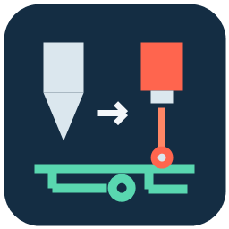

# PrevodnikNC — Laser & CNC PCB toolpaths

[English manual](docs/MANUAL_EN.md) · [Český návod](docs/MANUAL_CS.md) · [Downloads / Ke stažení](https://github.com/fiamko/Convertor-3d-gcode-to-lasercnc/releases)



## English

**Version 0.6 · Windows x64 · Czech interface · English and Czech manuals**

A desktop application for adapting existing PCB NC/G-code for laser processing
or CNC milling. It merges inputs, mirrors and rotates paths, marks drill
positions and lets you remove individual isolation contours using a matching
copper Gerber. It creates files; it does not connect to a machine.

Download **PrevodnikNC.exe** from Releases and run it directly, including from
a USB stick. The single windowed EXE includes Python, Tk, the icon and both
manuals. No installer, console window or configuration file beside the EXE is
needed. Open the embedded manual with **F1** or **Návod / F1**.

Settings, recipes and recovery snapshots are automatically stored in
`%APPDATA%\UpravaNC_Laser_CNC` on each computer. They do not travel with the
EXE unless you copy the profile separately. The bundle extracts libraries to
TEMP while running. This is a standalone program, not a promise of zero disk
writes. The binary is built for Windows x64; other systems need a separate build.

### What's new in 0.6

- CNC output with configurable depth, safe Z, plunge feed, RPM and drill-marking plunges.
- Separate laser power/feed and milling depth/feed tests with equal-width copper/gap subcolumns; laser negative-resist selection retained.
- Double-click paths in the contour dialog to keep/exclude them; reopen to continue the saved selection.
- Immediate canvas panning, blue original input preview and balanced preview panes.
- Output names such as `verze7-grb_drl.nc` (laser) and `verze7-grb_cnc.nc` (milling).
- One-file, console-free Windows distribution with embedded bilingual documentation.

Read the [full manual](docs/MANUAL_EN.md) for workflows, supported G-code,
limitations, recovery and settings. Check generated coordinates and process
parameters before using a machine. Height-map compensation is not provided.

## Česky

**Verze 0.6 · Windows x64 · české rozhraní · český a anglický návod**

Program upravuje existující PCB NC/G-code pro laser nebo frézku. Spojuje vstupy,
zrcadlí a otáčí dráhy, značí místa pro vrtání a umožňuje vyřazovat jednotlivé
izolační kontury s pomocí odpovídajícího Gerberu mědi. Vytváří soubory;
nepřipojuje se ke stroji.

Z vydání stáhněte **PrevodnikNC.exe** a spusťte přímo dvojklikem, třeba z USB.
Jediný EXE obsahuje Python, Tk, ikonu i oba návody. Nepotřebuje instalátor,
černé konzolové okno ani konfigurační soubor vedle sebe. Návod otevře **F1**
nebo tlačítko **Návod / F1**.

Nastavení, recepty a obnova se automaticky ukládají na daném počítači do
`%APPDATA%\UpravaNC_Laser_CNC`. S EXE se nepřenášejí, pokud profil nepřekopírujete
samostatně. Za běhu se knihovny rozbalují do TEMP. Přenosný program tedy
neznamená nulový zápis na disk. EXE je pro Windows x64, jiné systémy potřebují
vlastní sestavení.

### Novinky 0.6

- CNC výstup s nastavením ponoru, přejezdu Z, posuvu Z, otáček a značkovacích vpichů.
- Samostatné testy výkon/posuv a ponor/posuv se sloupečky měď/mezera 1:1; u laseru zachovaná volba negativního rezistu.
- Dvojklikem v dialogu kontur přepínáte ponechat/odebrat; další otevření naváže na uložený výběr.
- Plynulý posun náhledu, modrý originál vlevo a vyvážené náhledové panely.
- Názvy jako `verze7-grb_drl.nc` pro laser a `verze7-grb_cnc.nc` pro frézku.
- Jediné Windows EXE bez konzole a s vestavěnou dvojjazyčnou dokumentací.

[Úplný návod](docs/MANUAL_CS.md) popisuje postupy, podporované příkazy, omezení,
obnovu i nastavení. Před výrobou zkontrolujte souřadnice a parametry technologie.
Program neprovádí výškovou kompenzaci.

## Development / Vývoj

Python 3.10+ with Tkinter is required only for source development. The app
itself uses the standard library. Start `python PrevodnikNC.py`, or open
`PrevodnikNC.pyw` on Windows for a source launch without a console.

Build on Windows x64:

```console
python -m pip install pyinstaller==6.22.3
python build_exe.py
```

Output: `dist/PrevodnikNC.exe`. The build runs its embedded self-test.
`--staged` writes to `build/exe-staging/PrevodnikNC.exe` instead.
`--onedir` retains the development folder bundle; distribute its whole folder.
The legacy `.cmd` launcher is a source/development fallback and can show a console.

```console
python -m unittest test_nc_core test_features test_contours test_negative test_preferences test_milling test_feedback test_output_naming
python test_gui_smoke.py
python test_contour_gui.py
python test_preview_fit.py
python test_milling_gui.py
python test_feedback_gui.py
python test_mouse_gui.py
```

GUI checks require an interactive desktop with Tk. Two tests using private
manufacturing inputs skip when those files are absent. Public examples are
synthetic; private PCB projects, local profiles and recovery files are not
part of the repository. GitHub Actions runs tests and builds the single EXE.

Packaging reference: [PyInstaller operating modes](https://pyinstaller.org/en/stable/operating-mode.html).
Project licence: [LICENSE](LICENSE). Release source is available at the matching Git tag.
